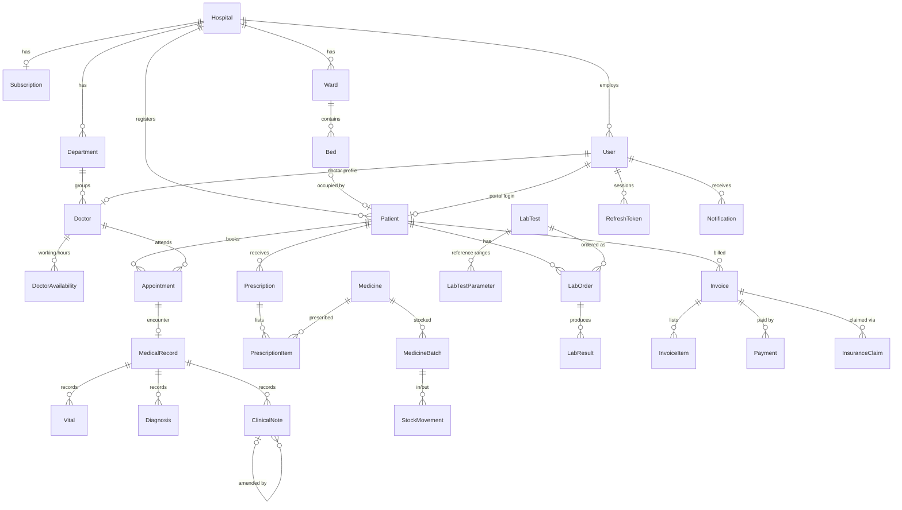

# MedCore HMS — Database design

PostgreSQL 16, managed with Prisma 6. The full schema is in
[apps/api/prisma/schema.prisma](../apps/api/prisma/schema.prisma) and the initial
migration (including triggers and CHECK constraints) is in
[apps/api/prisma/migrations](../apps/api/prisma/migrations).

## Four design rules

| Rule | How it's enforced |
|---|---|
| **Tenant isolation** — a hospital's data is only visible to that hospital | Every hospital-owned table has `hospitalId`. The API derives the hospital from the signed-in user (never from the request body) and filters every query by it. Rows from another hospital return **404**, so IDs can't be probed. |
| **Append-only clinical history** | `Vital`, `Diagnosis`, `ClinicalNote` and `AuditLog` have `BEFORE UPDATE OR DELETE` triggers that raise an error — even direct SQL can't change them. A correction is a new `ClinicalNote` with `amendsId` pointing to the original. |
| **Money is exact** | All amounts use `Decimal(12,2)`. A CHECK constraint keeps `Invoice.amountPaid` between 0 and `total`. |
| **No plain-text secrets** | Passwords: bcrypt (cost 12). Refresh tokens: SHA-256 hash only. OTP codes: HMAC-SHA256 only. |

## Entity overview

## Important relationships explained

**Hospital → everything.** `Hospital` is the tenant root. Users, patients, departments,
appointments, medicines, lab tests, invoices and audit logs all carry `hospitalId`, and
composite unique keys are scoped to it (e.g. `@@unique([hospitalId, mrn])`), so two
hospitals can both have a patient `MC-100101` without clashing.

**User vs. Doctor vs. Patient.** `User` is anyone who can sign in, with exactly one `Role`.
Doctors get an extra 1-to-1 `Doctor` row for clinical details (specialization, license,
fee, working hours). A `Patient` is a clinical record that *may* have a linked `User`
(`Patient.userId`) when the person uses the patient portal; walk-in patients registered at
the front desk have no login. The `SUPER_ADMIN` user has `hospitalId = null`.

**Roles and permissions.** `Role` is an enum; `RolePermission` maps each role to
permission strings (`patients:read`, `lab:process`…). Endpoints declare the permission they
need and the `PermissionsGuard` checks it on every request.

**Appointment → MedicalRecord → clinical rows.** A booked `Appointment` becomes a
`MedicalRecord` (one encounter) when the doctor starts the consultation. Vitals, diagnoses and
notes hang off the record, so the history reads visit by visit. BMI is stored on the `Vital`
row at the moment it was measured.

**Prescription → pharmacy.** `PrescriptionItem` references a `Medicine`; dispensing deducts from
`MedicineBatch` rows in first-in-first-out order (earliest expiry first, expired batches
skipped) and writes a `StockMovement` for each deduction. A CHECK constraint stops stock going
below zero.

**Lab.** `LabTest` defines the test and its `LabTestParameter` reference ranges. A `LabOrder`
moves through `ORDERED → SAMPLE_COLLECTED → PROCESSING → RESULT_ENTERED → APPROVED`.
`LabResult` copies the reference range at the time of testing and stores `isAbnormal`, so a later
change to the ranges doesn't rewrite old reports. Patients only see `APPROVED` orders.

**Billing.** `Invoice` totals are computed on the server from `InvoiceItem` rows (quantity ×
price + GST). `Payment` rows start `PENDING` for online gateways and only become `SUCCEEDED`
after the server verifies the gateway signature; cash/card/UPI at the counter are recorded as
`SUCCEEDED` by staff. `InsuranceClaim` links an invoice to its claim workflow.

**Sessions.** Every sign-in creates a `RefreshToken` *family*. Each refresh rotates the token
(old one revoked, `replacedBy` set). If a revoked token is ever presented again, the whole
family is revoked, signing out whoever stole it.

## Indexes

Indexes follow the main screens' queries, for example `Appointment(doctorId, startsAt)` for a
doctor's day, `Appointment(hospitalId, startsAt)` for the front desk,
`LabOrder(hospitalId, status)` for the lab worklist, `MedicineBatch(medicineId, expiresOn)` for
FIFO and `Notification(userId, readAt, createdAt)` for the notification bell.

## Seed data

`npm run db:seed` loads **fictional** data: three hospitals (two active, one awaiting
verification), staff for every role, doctors with working hours, 20 patients, appointments for
today and the coming days, an encounter with vitals/diagnosis/notes, medicines with expired
and low-stock batches, lab orders with abnormal results, invoices, payments and insurance claims.
All emails use the reserved `.test` domain.
